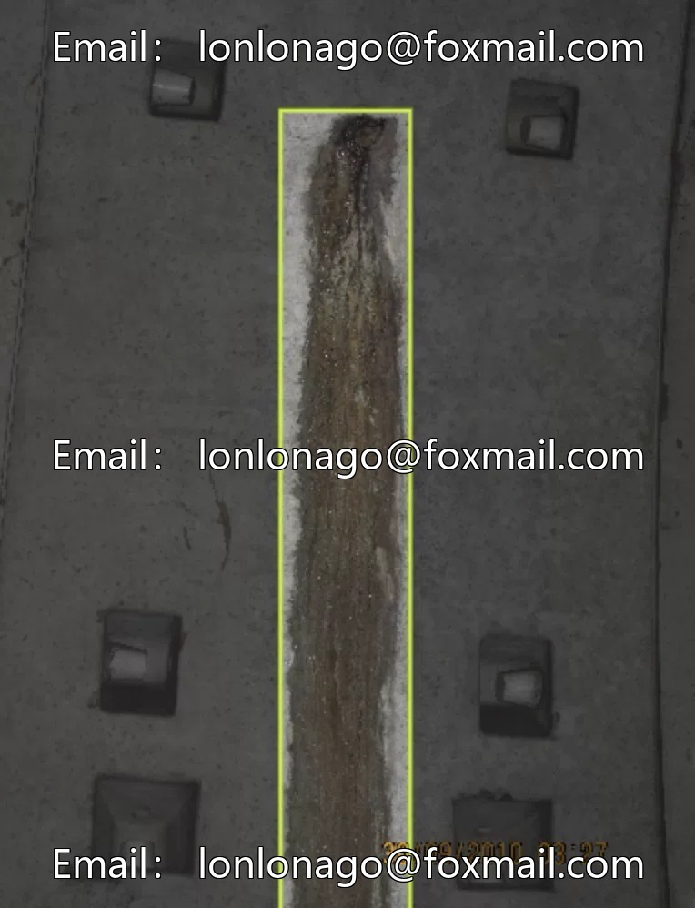
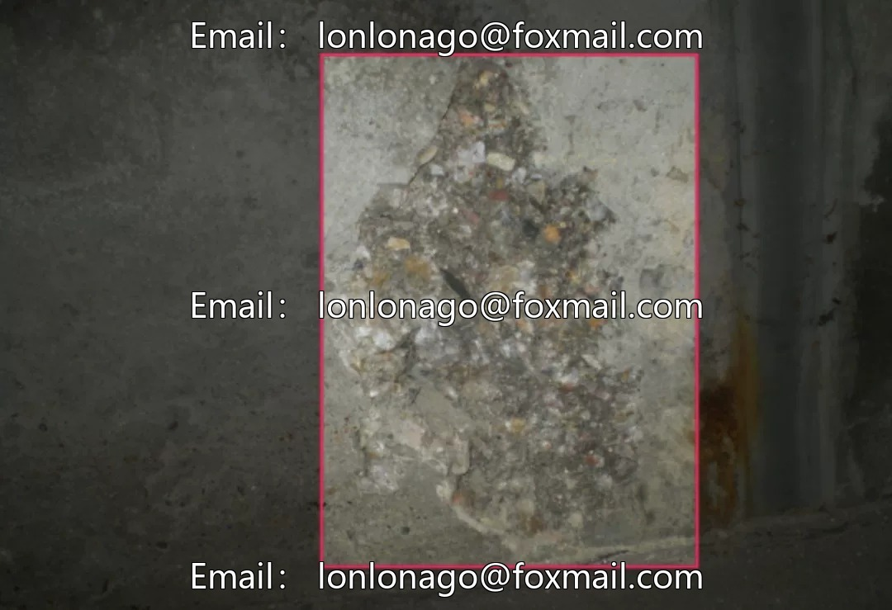
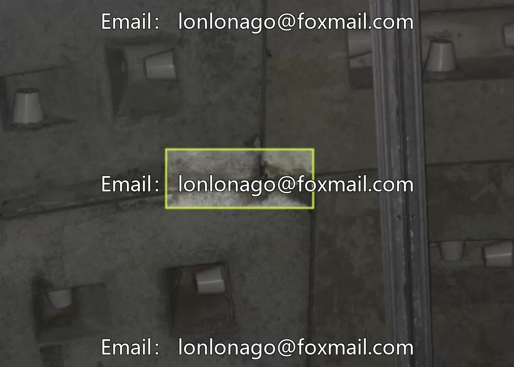
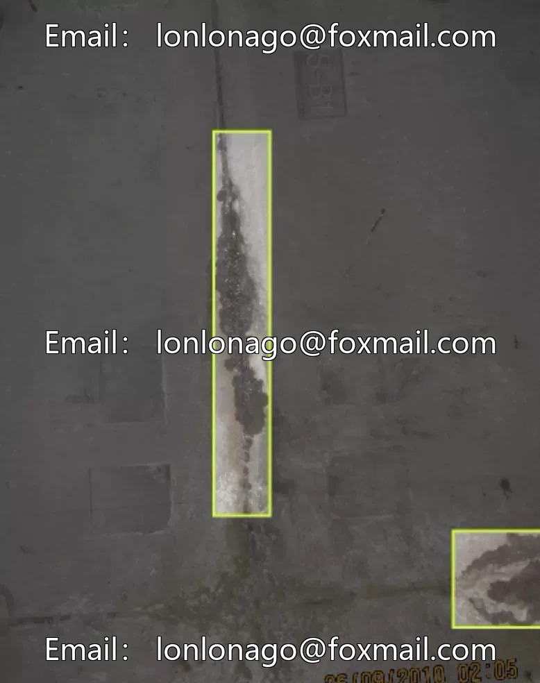
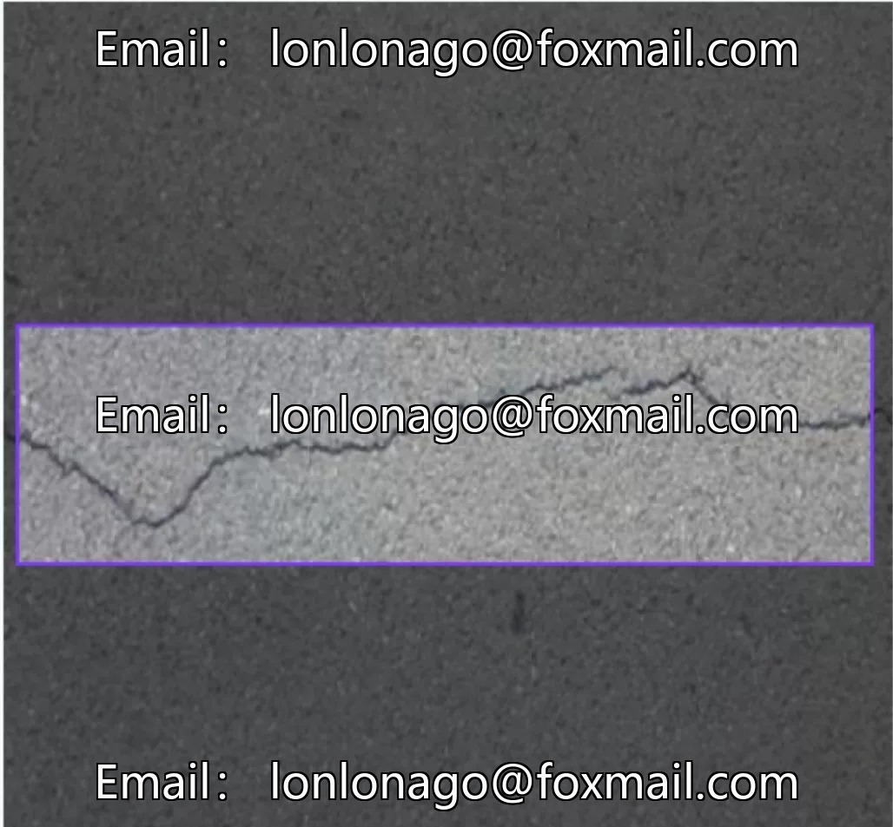
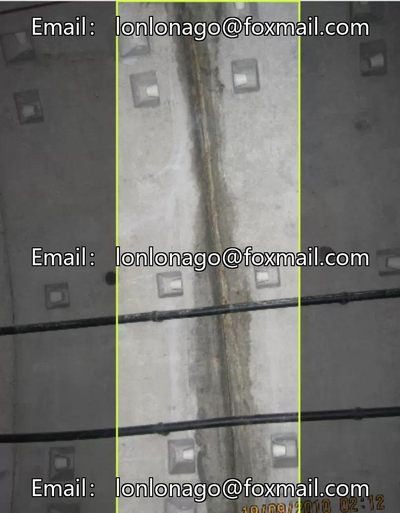

# Intelligent Tunnel Identification Dataset, Issue 10210, Computer Vision Object Detection Category, package

## Body

Intelligent Tunnel Identification Dataset, Issue 10210, Computer Vision Object Detection Category, including core targets such as tunnel cracks, seepage, peeling, and defects. 3234 images are integrated into a complete dataset, supporting model training and testing.

The dataset format is primarily image files, allowing direct upload of local files for model testing. Suitable for target detection tasks in tunnel scenarios, it provides high-quality training data to support the development of AI models for tunnel safety monitoring and fault identification.

Virtual materials, once sold, are non-refundable.
Interested friends, click "I want" to proceed.

## Images

## Payment

Here is a pay link on Stripe ( https://buy.stripe.com/3cs8yP7sY87d0vu9AB ). Please contact me lonlonago@foxmail.com after funding $89, and I will send you a complete data files , thank you!

